# StitchCore — Delivery Plan and Source of Truth

> **Purpose:** This document is the execution plan for building StitchCore. Read it before making architectural, product, or infrastructure changes. Update it when a material decision, scope boundary, or milestone changes.

## 1. Product mission

StitchCore is an on-demand, managed clothing-alteration service. A customer submits garments that do not fit, states the required alteration and relevant measurements, selects a pickup window, and receives the altered garments back. StitchCore coordinates pickup, vendor handover, alteration completion, return collection, and delivery.

The initial product succeeds when a customer can place an order in a few minutes and the operations team can reliably maintain custody, complete an alteration, and return every garment on time.

### MVP operating model

- Launch in one small, dense service area only.
- Use one trusted alteration vendor and one or two logistics partners.
- Batch collection in the evening, hand garments to the vendor, then collect and deliver completed garments the following day.
- Keep routing, vendor allocation, quality checks, and exception decisions manual.
- Offer a limited catalogue of predictable, standard alterations first.
- Use a fixed price catalogue whenever possible. Send exceptions to admin/customer approval before work begins.

### Initial service catalogue

| Garment | Supported initial services |
|---|---|
| Trousers | Hem/length, waist in/out, taper, seat adjustment |
| Shirt | Sleeve length, side fitting, shirt length |
| Kurta | Sleeve length, side fitting, hem/length |
| Dress/skirt | Hem/length, basic side fitting |

Not initially supported: expensive wedding garments, leather, major redesigns, complicated embroidery work, or unpriced custom work.

## 2. Goals, success metrics, and constraints

### Product goals

1. Make order placement feel premium, simple, and trustworthy.
2. Make each garment traceable from pickup through return delivery.
3. Give operations staff the minimum tools needed to run the service manually without spreadsheets becoming the system of record.
4. Keep the technical system inexpensive and operationally simple for a one-city pilot.

### Pilot success metrics

| Metric | Initial target |
|---|---|
| Customer order completion | ≥ 70% after entering the order flow |
| Pickup success rate | ≥ 90% on first attempt |
| On-time delivery | ≥ 90% against promised date |
| Garment custody incidents | 0 |
| Rework rate | Track from day one; use findings to improve measurement flow |
| Status-notification delivery | ≥ 95% successful or retryable |
| Average turnaround | Define per service area; initially 24–48 hours |

### Non-negotiable constraints

- PostgreSQL is the permanent source of truth for all business data.
- No order status change may be silently overwritten; every change needs an immutable audit event.
- A logistics partner can only access orders assigned to that partner.
- Customer address and phone data are visible only to customer, admin, and the assigned logistics partner.
- All monetary values are stored in **paise** as integers; never use float/decimal rupees in API business logic.
- Images are stored privately; clients receive signed URLs rather than public storage URLs.
- No secrets, AWS credentials, payment credentials, or provider tokens are committed to Git.

## 3. Roles and permissions

### Customer

- Sign in by phone OTP.
- Manage own profile and saved addresses.
- Create an order, submit garments, select alteration services, attach measurements/photos, select pickup slot, and pay.
- View only own orders, garments, receipts, notifications, and rework requests.
- Track order timeline and receive delivery updates.

### Admin / operations

- See all orders, customers, garments, vendors, logistics assignments, payments, status events, notifications, and exceptions.
- Assign/reassign logistics partner and vendor manually.
- Update any valid status and resolve exceptions.
- Configure catalogue, pricing, service areas, pickup slots, vendors, and partner accounts.
- Approve price changes, refunds, cancellation, and rework decisions.
- Review delayed orders and notification failures.

### Logistics partner

- See only their assigned tasks and the minimum customer information required to execute them.
- Open navigation/call links for assigned pickups and deliveries.
- Confirm garment count, scan/enter garment QR ID, capture condition/proof photos, and record notes.
- Mark allowed task/status transitions only.
- Cannot change prices, vendor, customer, payment, or other partner assignments.

### Vendor

Vendor capability is intentionally minimal in the first release.

- Vendor may eventually have a web profile to see only orders assigned to that vendor.
- Vendor may mark alteration work complete and add notes/photos, subject to admin review.
- Until that interface is proven necessary, vendor work is coordinated by admin/logistics through secure job links or WhatsApp.

## 4. Customer and operations workflows

### 4.1 Customer order journey

1. Customer signs in using phone OTP.
2. Customer selects or creates pickup/delivery address.
3. Customer adds one or more garments.
4. For each garment, customer selects a supported alteration service.
5. Customer supplies one of the measurement methods described in section 5.
6. Customer adds optional notes and reference photos.
7. System displays transparent service price, pickup fee, pickup slot, and estimated return date.
8. Customer reviews order and pays using Razorpay.
9. System confirms the order and shows a trackable order number.
10. Customer receives status updates until delivery is complete.

### 4.2 Manual operational lifecycle

```text
Customer order
  → Admin assigns logistics partner and vendor
  → Logistics partner picks up garments and records proof
  → Logistics/admin confirms vendor handover
  → Vendor completes alteration
  → Admin/logistics marks completion/readiness
  → Logistics partner collects completed garments
  → Logistics partner delivers and records proof
```

### 4.3 Status state machine

```text
placed
  → pickup_assigned
  → picked_up
  → at_vendor
  → alteration_complete
  → ready_for_delivery
  → out_for_delivery
  → delivered
```

Exception paths:

```text
pickup_assigned → pickup_failed → pickup_assigned | cancelled
at_vendor → customer_approval_needed → at_vendor | cancelled
at_vendor | delivered → rework_required → at_vendor | alteration_complete
placed | pickup_assigned → cancelled
```

Each transition must write:

- `from_status` and `to_status`
- authenticated actor
- timestamp
- optional note
- optional proof photo/document reference

### 4.4 Garment custody rules

- Generate a customer-facing `ORD-YYYYMMDD-XXXXXX` order number.
- Generate a unique `GRM-XXXXXXXX` QR-friendly identifier for every garment line item.
- Require pickup confirmation before `picked_up`.
- Require vendor handover acknowledgement before `at_vendor`.
- Require delivery OTP or proof photo/signature before `delivered`.
- Preserve condition notes and evidence to resolve loss/damage disputes.

## 5. Measurement framework

The measurement experience must be structured but low-friction. Do not require a full body-measurement form by default.

### 5.1 Measurement modes

| Mode | Customer action | Best use |
|---|---|---|
| Direct alteration delta | “Shorten by 2 inches” or “reduce waist by 1 inch” | Standard/low-risk alterations |
| Final garment measurement | “Finished waist should be 32 inches” | Customers who know garment measurements |
| Reference garment | Add photo/details of a well-fitting garment | Fit matching where direct dimensions are unclear |
| Pickup measurement | Select “measure at pickup” | Customer does not know required measurements |
| Tailor recommendation | Customer gives a goal; admin/vendor seeks approval | Exceptional/custom work only |

### 5.2 Structured measurement schema

Each `AlterationItem` must store a versioned structured JSON payload rather than free text only.

```json
{
  "schema_version": 1,
  "measurement_mode": "alteration_delta",
  "unit": "in",
  "values": {
    "waist_reduce_by": 1
  },
  "reference_garment": null,
  "customer_confirmation": true
}
```

Use service-specific validation rules. Examples:

```text
trousers.reduce_waist:
  required: waist_reduce_by OR target_waist OR pickup_measurement
  valid unit: in | cm
  allowed range: configured safe range

shirt.shorten_sleeve:
  required: shorten_by OR target_sleeve_length OR pickup_measurement
```

### 5.3 Measurement product requirements

- Display diagrams and plain-language guidance for each measurement when a user needs to enter it.
- Use inches and centimetres; store both original input and normalized value where useful.
- Show a human-readable final instruction before payment.
- Require customer confirmation for any admin/vendor price or measurement change.
- Keep a saved measurement profile optional, encrypted/permissioned, and editable by the customer.
- Record who captured a pickup measurement and when.
- Do not add AI sizing or photo-based automated measurement to the MVP.

## 6. Product surfaces

### 6.1 Customer website

Implement a mobile-first Next.js web application. It must work excellently in a mobile browser before native applications are released.

Required screens:

- Landing/service-area check
- Phone OTP sign-in/sign-up
- Service catalogue and pricing
- Saved addresses
- New order wizard
- Garment/alteration/measurement details
- Photo upload
- Pickup slot selection
- Checkout and Razorpay payment
- Order confirmation
- Order history and order detail/timeline
- Saved measurements
- Help/support and rework request

### 6.2 Customer mobile apps

Build a shared React Native + Expo app for Android and iOS after the core web flow/API is stable.

Required capability:

- Same customer flows as website.
- Push-notification permission and FCM device registration.
- Camera/photo uploads.
- Deep links from WhatsApp/push into order details.
- Secure storage for session token.

### 6.3 Admin web dashboard

Start with Django Admin for operational validation. Build a dedicated Next.js admin dashboard when workflows stabilize.

Required dashboard capabilities:

- Order board searchable by order number, customer phone, status, date, vendor, and logistics partner.
- Order detail: garments, instructions, photos, QR IDs, payment, address, full audit timeline, and notifications.
- Manual assignment to logistics partner and vendor.
- Exception queues: pickup failed, approval needed, overdue, rework, failed notification, refund/cancellation.
- Service catalogue and price management.
- Vendor and logistics partner management.
- Daily operations list with filtering/export; **not** automatic route optimization.
- Basic operational reporting: order volume, turnaround, cancellation, rework, and delivery failures.

### 6.4 Logistics mobile mode

Implement as a role-specific area of the same React Native application, not a separate backend or codebase.

Required screens:

- Today’s assigned tasks grouped as pickup/delivery/vendor handover.
- Task detail with customer name, masked/unmasked contact according to assignment, address, map link, notes, garments, and expected action.
- QR scanner/manual code entry.
- Pickup confirmation: count, photo, condition note.
- Vendor handover / collection confirmation.
- Delivery confirmation: delivery OTP and/or proof photo.
- Failure reason and reschedule request.
- Offline-friendly drafts for proof capture; upload/reconcile when connection returns.

### 6.5 Vendor web profile (phase after manual pilot)

Required only after vendor workflow is validated:

- Vendor login and own assigned-job list.
- Garment/alteration instructions, photos, and due date.
- Mark “alteration complete” with notes.
- No access to unrelated customer data/orders.
- Admin retains final control of fulfillment status.

## 7. Backend core service

### 7.1 Technology and repository direction

- Language/framework: Python, Django, Django REST Framework.
- Database: PostgreSQL locally via Docker where possible; Amazon RDS PostgreSQL in AWS.
- API style: versioned JSON REST API, starting at `/api/v1/`.
- Authentication: secure phone OTP plus short-lived access token/refresh-token flow.
- API contract: generate and publish OpenAPI schema; clients use generated/shared typed contracts where practical.
- Background work: **SQS plus Lambda only** for notification delivery. Do not add Redis or Celery to MVP.

Suggested repository layout after the application grows:

```text
StitchCoreService/
  backend/                 Django project and domain apps
  frontend/web/            Next.js customer/admin/vendor web application
  frontend/mobile/         React Native / Expo app
  packages/contracts/      OpenAPI-generated or shared API types
  infra/cdk/               AWS CDK application
  tests/integration/       Black-box API/infrastructure tests
  docs/                    ADRs, runbooks, API/integration docs
  task.md                  This source of truth
  AGENTS.md                Durable agent/developer working rules
```

### 7.2 Domain modules

| Module | Responsibility |
|---|---|
| `accounts` | User, role, phone OTP, sessions, device tokens, consent |
| `catalog` | Garment types, alteration services, measurement schemas, pricing, serviceability |
| `orders` | Cart/order, garments, alterations, totals, lifecycle/state machine, audit events |
| `fulfillment` | Logistics assignment, vendor assignment, pickup/delivery proofs, exception tasks |
| `payments` | Razorpay order creation, webhook verification, refunds, payment ledger |
| `media` | S3 signed upload/download URLs, metadata, virus/type/size validation |
| `notifications` | Notification jobs, SQS publishing, provider callback, delivery audit |
| `support` | Rework, cancellation, customer approvals, notes |
| `reporting` | Read-only operational summaries and exports |

### 7.3 Core data model

Implement/extend these entities with migrations and constraints:

| Entity | Key fields/relationships |
|---|---|
| User | id, phone, name, role, active, consent metadata |
| Address | user, label, address fields, geo coordinates, serviceability state |
| Vendor | name, contacts, service area, active, supported services |
| LogisticsPartner | user/profile, active, service area, internal notes |
| Service | code, garment type, name, measurement schema/version, base price, active |
| ServicePrice | service, market/service area, effective period, price paise |
| Order | public number, customer, address snapshot, status, pickup slot, expected return, totals, payment state |
| Garment | order, type, QR ID, color/brand, condition notes, custody/photo metadata |
| AlterationItem | garment, service, measurement payload/version, customer notes, quoted/approved price |
| Assignment | order, logistics partner, vendor, assigned by, timestamps |
| StatusEvent | order, from/to status, actor, timestamp, note, proof reference |
| MediaAsset | owner/entity link, S3 key, media type, checksum, uploader, upload status |
| Payment | order, Razorpay IDs, amount paise, state, webhook payload reference, refund state |
| NotificationJob | order, channel, template, recipient, payload, status, provider ID, retry/error state |
| CustomerApproval | order, requested change, before/after values, expiry, decision, approver |
| ReworkRequest | order/garment, reason, evidence, decision, resolution |

### 7.4 API requirements

#### Customer APIs

```text
POST   /api/v1/auth/otp/request
POST   /api/v1/auth/otp/verify
POST   /api/v1/auth/refresh
GET    /api/v1/me

GET    /api/v1/addresses
POST   /api/v1/addresses
PATCH  /api/v1/addresses/{id}

GET    /api/v1/catalog/services
GET    /api/v1/catalog/serviceability
POST   /api/v1/orders/quote
POST   /api/v1/orders
GET    /api/v1/orders
GET    /api/v1/orders/{id}
POST   /api/v1/orders/{id}/cancel-request
POST   /api/v1/orders/{id}/rework-request

POST   /api/v1/media/upload-url
POST   /api/v1/payments/create-order
POST   /api/v1/devices
```

#### Operations APIs

```text
GET    /api/v1/admin/orders
POST   /api/v1/admin/orders/{id}/assign
POST   /api/v1/admin/orders/{id}/status
POST   /api/v1/admin/orders/{id}/approve-change
GET    /api/v1/admin/exceptions
CRUD   /api/v1/admin/catalog/services
CRUD   /api/v1/admin/catalog/prices
CRUD   /api/v1/admin/vendors
CRUD   /api/v1/admin/logistics-partners
```

#### Logistics APIs

```text
GET    /api/v1/logistics/tasks?date=YYYY-MM-DD
GET    /api/v1/logistics/tasks/{id}
POST   /api/v1/logistics/orders/{id}/pickup-confirmation
POST   /api/v1/logistics/orders/{id}/vendor-handover
POST   /api/v1/logistics/orders/{id}/vendor-collection
POST   /api/v1/logistics/orders/{id}/delivery-confirmation
POST   /api/v1/logistics/orders/{id}/failure
```

#### Webhooks/internal APIs

```text
POST /api/v1/webhooks/razorpay
POST /api/v1/internal/notifications/{job_id}/delivery
```

All webhook handlers must verify the provider signature, be idempotent, and write an audit record.

### 7.5 Backend functional acceptance criteria

- A customer cannot submit an order using another customer’s address.
- An order total is calculated only on the server from active catalogue pricing.
- Every garment has a unique ID before pickup.
- Invalid or unauthorized state transitions fail without changing database state.
- A logistics partner cannot retrieve or update an unassigned order.
- Assigning a partner/vendor and changing status appear in the audit timeline.
- Payment webhooks are safe to replay.
- Notification failure never rolls back a successful order/status transaction.
- API validation errors are structured and suitable for client rendering.

## 8. Notifications and external integrations

### 8.1 Notification policy

| Event | Customer | Logistics | Admin |
|---|---|---|---|
| Order placed/payment confirmed | Push + WhatsApp | — | Dashboard |
| Pickup assigned | Optional | Push + WhatsApp task link | Dashboard |
| Picked up | Push + WhatsApp | — | Dashboard |
| Approval needed | Push + WhatsApp | — | Dashboard/alert |
| Ready/out for delivery | Push + WhatsApp | Push/task | Dashboard |
| Delivered | Push + WhatsApp | — | Dashboard |
| Failed operation | Appropriate alert | Task update | Dashboard/alert |

### 8.2 Integration design

- **Razorpay:** server creates payment order; web/mobile completes checkout; Razorpay webhook is authoritative for payment result.
- **WhatsApp:** choose a BSP before implementation; use approved templates and secure task links. Do not transmit the full address in message text.
- **FCM:** register device tokens per user/device/platform; deep-link notification to the relevant order/task.
- **SMS:** OTP and high-priority fallback only.
- **S3:** client requests presigned upload URL; server validates attachment metadata; media persists as private object.
- **SQS/Lambda:** Django creates persistent notification job then publishes a minimal payload after DB commit. Lambda sends provider request, retries via SQS, and records final result using protected internal API.

## 9. AWS CDK infrastructure package

### 9.1 CDK principles

- Use AWS CDK v2 with TypeScript.
- Keep all infrastructure under `infra/cdk/`.
- Use separate AWS accounts for beta and production if possible; at minimum use separate stacks, databases, buckets, queues, and secrets.
- Default target region: `ap-south-1` (Mumbai).
- All infrastructure changes are reviewed through pull requests and deployed through CI/CD; avoid console-created production resources.
- Tag all resources with `Project=StitchCore`, `Environment`, `Owner`, and `CostCenter`.

### 9.2 Environments

| Environment | Purpose | Data | Public access |
|---|---|---|---|
| Local | Developer tests | Local/sample data | Local only |
| Beta | Internal/pilot validation | Synthetic + approved beta customer data | Restricted real domain |
| Production | Live customers | Real data | Live domain only |

### 9.3 CDK stacks

```text
FoundationStack
  - VPC/subnets/security groups (keep initial networking simple)
  - Route 53 hosted-zone references / ACM certificates
  - KMS keys where appropriate
  - CloudWatch log groups / retention policies

DataStack
  - RDS PostgreSQL instance/cluster, subnet/security group, backups
  - S3 private media bucket, encryption, lifecycle rules, CORS
  - Secrets Manager database credentials and application secrets

ComputeStack
  - ECR repositories for backend and web images
  - ECS cluster, Fargate task definition/service for Django API
  - Application Load Balancer, HTTPS listener, health checks
  - ECS task roles with least privilege
  - Lambda function for notifications

MessagingStack
  - SQS notification queue
  - Dead-letter queue and alarm
  - SQS-to-Lambda event source mapping

EdgeStack
  - CloudFront/S3 or ECS hosting design for web app
  - DNS records and TLS

ObservabilityStack
  - CloudWatch dashboards
  - Alarms: API 5xx, ECS task failure, Lambda failure/throttle, SQS backlog/DLQ, RDS capacity
  - Alert notification topic/integration
```

### 9.4 Network/cost approach

- Begin with one API Fargate task at 0.5 vCPU / 1 GB and scale after load evidence.
- Use a private RDS instance inaccessible from the public internet.
- Do not introduce a NAT Gateway by default; assess the egress design deliberately because it can materially raise MVP cost.
- Use VPC endpoints or an approved simplified network design only after security/cost review.
- Use S3 lifecycle policies for media retention and deletion policy.
- Configure database backups, restore testing, and deletion protection for production.

### 9.5 CDK acceptance criteria

- `cdk synth` succeeds in CI for beta and production configurations.
- `cdk diff` is reviewed before any production change.
- Each stack deploys cleanly into a new beta account/namespace.
- ECS task can read only needed secrets and write only permitted S3/SQS/log resources.
- API health endpoint is reachable only through the expected load balancer/domain route.
- SQS failure routes to a DLQ and produces an alarm.
- Destructive resource deletion is blocked or requires explicit break-glass approval in production.

## 10. CI/CD and release process

### 10.1 Branching strategy

```text
main                protected; always deployable
feature/*           short-lived development branches
release/*           optional stabilization branches only if needed
```

Every feature reaches `main` through a pull request with required checks. Do not commit directly to protected `main` after initial bootstrap.

### 10.2 Pipeline stages

```mermaid
flowchart LR
  PR["Pull request"] --> CHECKS["Lint · type-check · unit tests · security scan"]
  CHECKS --> PREVIEW["Build images · CDK synth/diff"]
  PREVIEW --> MERGE["Merge to main"]
  MERGE --> BETA["Deploy beta"]
  BETA --> INTEGRATION["Run integration + smoke tests"]
  INTEGRATION --> APPROVAL["Manual production approval"]
  APPROVAL --> PROD["Deploy production"]
  PROD --> SMOKE["Production smoke test + monitoring"]
```



### 10.3 Pull request pipeline

Run on every pull request:

- Format/lint Python, TypeScript, YAML, Dockerfiles, and CDK code.
- Run Python type checks and frontend type checks.
- Run backend unit tests and migration consistency checks.
- Run frontend unit/component tests.
- Build Docker images without pushing production tags.
- Run dependency and secret scanning.
- Run `cdk synth` for beta and production configurations.
- Publish a `cdk diff` summary for infrastructure changes.
- Optionally deploy a temporary preview environment only after cost/security review.

### 10.4 Beta deployment pipeline

Trigger: merge to `main`.

1. Build immutable backend/web container artifacts tagged with commit SHA.
2. Push images to ECR.
3. Deploy CDK beta stacks.
4. Run database migrations as a one-off ECS task using a locked, idempotent migration job.
5. Update ECS service using rolling or blue/green deployment.
6. Wait for ALB/ECS health checks.
7. Run integration suite against beta.
8. Publish deployment result, revision, migration version, and test report.

Beta must use its own RDS database, S3 prefix/bucket, SQS queues, and provider sandbox/test credentials where available.

### 10.5 Production deployment pipeline

Trigger: explicit manual approval of a beta-validated commit/tag.

1. Verify the same immutable artifact SHA passed beta integration tests.
2. Require human approval by an authorized maintainer.
3. Take/verify database backup and migration rollback plan.
4. Deploy production CDK changes.
5. Run production-safe database migrations.
6. Deploy ECS application with health checks and rollback on failure.
7. Run non-destructive production smoke tests.
8. Monitor alarms/error rate for a defined window.
9. Record deployment metadata and notify the team.

Never run seeded test data, destructive cleanup, or real WhatsApp/SMS notification tests against production.

### 10.6 Deployment safety

- Use GitHub Actions with AWS OIDC federation; do not store long-lived AWS access keys in GitHub secrets.
- Store third-party credentials in AWS Secrets Manager and inject only at runtime.
- Require environment protection rules for production.
- Version database migrations and make them backwards-compatible where rolling deployments overlap versions.
- Keep a documented rollback procedure: application rollback, feature flag disablement, database forward-fix strategy.

## 11. Testing strategy

### 11.1 Test layers

| Layer | Scope | Runs when |
|---|---|---|
| Unit tests | Domain services, serializers, permissions, pricing, state machine | Every PR |
| API tests | REST request/response, auth, validation, object-level authorization | Every PR |
| Database tests | Migrations, constraints, transaction/idempotency behavior | Every PR and beta |
| Frontend component tests | Forms, measurement input, status presentation, role gating | Every PR |
| End-to-end tests | Customer, admin, logistics browser/mobile-critical workflows | Beta deployment |
| Integration tests | Razorpay/WhatsApp/FCM/SQS/Lambda adapters using test/sandbox modes | Beta deployment |
| Infrastructure tests | CDK assertions, synth/diff, deploy smoke validation | Every PR/beta |
| Security tests | Dependency/secret scan, permission tests, auth abuse cases | Every PR + scheduled |
| Performance checks | Quote/order/status API baseline under expected pilot load | Before launch and release milestones |

### 11.2 Mandatory backend scenarios

- Customer OTP request/verify throttling and invalid-code handling.
- Customer can create an order only with own serviceable address.
- Unsupported garment/service/measurement combinations are rejected.
- Server calculates price independently of client-provided totals.
- One order supports multiple garments and multiple alterations.
- Each valid state transition creates one immutable `StatusEvent`.
- Every forbidden transition is rejected.
- Logistics partner cannot access another partner’s order.
- Admin can assign/reassign partner/vendor and action appears in audit data.
- Payment webhook signature validation, idempotency, duplicate delivery, and refund state.
- S3 signed uploads reject unsupported file type/oversize requests.
- Notification job persists even if SQS publish/provider delivery fails.
- Lambda retry and DLQ behavior are tested with simulated provider failure.

### 11.3 Mandatory end-to-end beta scenarios

1. Customer signs in, creates address, chooses trousers waist alteration, supplies measurement, pays in Razorpay test mode, and sees confirmed order.
2. Admin assigns logistics partner and vendor.
3. Logistics partner sees only assigned task, records QR/proof, and marks pickup.
4. Customer receives simulated or sandboxed notification and sees timeline update.
5. Admin/logistics completes vendor and delivery statuses.
6. Logistics partner completes delivery with proof/OTP.
7. Customer sees delivered order and may open a rework request.
8. Admin handles a failed pickup and reschedules it.
9. Approval-needed flow prevents alteration completion until customer/admin approval.
10. Unauthorized customer/logistics user receives `403`/`404` and no sensitive information.

### 11.4 Test data and environments

- Use factories/fixtures, not production database snapshots, in CI.
- Test phone numbers, Razorpay sandbox credentials, and provider sandbox/mock adapters are mandatory for beta.
- Mask/redact phone numbers, addresses, tokens, and payment data in logs and test reports.
- Seed beta test users for each role and make reset scripts safe/idempotent.

## 12. Implementation roadmap

### Phase 0 — Foundation (complete/partially complete)

- [x] Establish Django/DRF repository foundation.
- [x] Implement initial domain models for users, address, vendor, order, garment, alterations, status events, device tokens, and notification jobs.
- [x] Implement early order creation, assignment, status workflow, Django Admin, SQS publisher skeleton, Lambda skeleton, and basic test.
- [x] Create `AGENTS.md` and this implementation plan.
- [ ] Move API routes to `/api/v1/` and generate OpenAPI contract.
- [ ] Add local Docker Compose for Django, PostgreSQL, and test services.
- [ ] Add environment configuration template and contributor setup instructions.

### Phase 1 — Backend pilot readiness

- [ ] Phone OTP authentication and token lifecycle.
- [ ] Full catalogue, pricing, serviceability, pickup-slot, and quote engine.
- [ ] Production-ready order lifecycle and assignment history.
- [ ] Media uploads with S3 presigned URLs and proof metadata.
- [ ] Razorpay payment order, webhook verification, payment states/refunds.
- [ ] Customer approvals, cancellation, rework domains.
- [ ] Notification service interfaces and provider adapters/mocks.
- [ ] Complete authorization, audit, validation, and unit/API test coverage.

### Phase 2 — Customer web pilot

- [ ] Next.js project and design system.
- [ ] OTP, address, catalogue, order wizard, measurement framework, uploads.
- [ ] Razorpay checkout.
- [ ] Order tracking/history, support/rework.
- [ ] Responsive/mobile browser QA and accessibility baseline.

### Phase 3 — Operations and logistics

- [ ] Polish Django Admin views/actions for first operational pilot.
- [ ] Admin web dashboard order queue, assignment, exceptions, catalogue management.
- [ ] React Native/Expo app shell with customer and logistics roles.
- [ ] Logistics task workflow, QR scanning, photo proof, offline draft/retry support.
- [ ] Push notification device registration/deep links.
- [ ] Vendor profile only if manual pilot proves the need.

### Phase 4 — Infrastructure and deployments

- [ ] Scaffold TypeScript AWS CDK application and stack boundaries.
- [ ] Provision beta environment.
- [ ] Container build/ECR/ECS Fargate deployment.
- [ ] RDS/S3/SQS/Lambda/Secrets/monitoring setup.
- [ ] GitHub Actions PR checks and beta deployment.
- [ ] Production environment, approval gate, deployment/rollback runbooks.

### Phase 5 — Pilot launch hardening

- [ ] End-to-end beta suite covers all mandatory scenarios.
- [ ] Performance baseline and security review.
- [ ] Data privacy, support, incident, rework, and lost-garment runbooks.
- [ ] Staff training and dry-run pickup/vendor/delivery day.
- [ ] Controlled customer beta launch in one locality.

## 13. Definition of done

A feature is done only when:

- Product behavior matches this plan and has explicit acceptance criteria.
- Backend authorization and validation are enforced server-side.
- Unit/API tests cover normal and failure paths.
- UI handles loading, empty, validation-error, and retry states.
- Relevant audit events and notifications are emitted.
- Infrastructure changes are represented in CDK, not undocumented console changes.
- CI is green, beta is deployed/tested when applicable, and docs are updated.
- No secrets, personal data, or provider credentials are in source control or test logs.

## 14. Explicit MVP exclusions

- Automatic route optimization or live driver GPS tracking.
- Automatic vendor allocation.
- Automatic quality checks.
- Complex AI/photo measurement extraction.
- Dynamic surge pricing.
- Full vendor marketplace/multi-vendor bidding.
- Multi-city fulfillment automation.
- Redis/Celery task infrastructure.

## 15. Decisions requiring owner input before implementation

These do not block local backend work, but they block production integration:

1. Launch city/localities and serviceable pincodes.
2. Final standard service catalogue and price list.
3. Pickup/delivery fee and free-delivery threshold.
4. Turnaround promise by service type.
5. Rework, cancellation, loss/damage, and refund policy.
6. WhatsApp provider/BSP selection.
7. SMS provider selection.
8. OTP approach/vendor.
9. Razorpay merchant account and webhook configuration.
10. Customer-facing brand, domain, and design direction.
11. Beta/production AWS account separation and deployment approvers.

